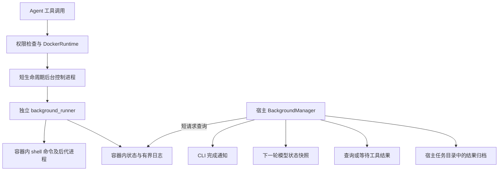

# 通用后台任务与结果返回方案

日期：2026-10-02  
状态：已按本方案实现并完成本机验收。本文保留设计依据与实施顺序；实际入口和用法见 README 的“通用后台任务”。源码增加了工具声明、容器 runner、宿主管理、Agent 结果交付和 CLI 通知。

## 1. 推荐结论

在现有 Docker 沙箱中增加**受管理的后台命令任务**：启动后立即返回任务编号，命令由容器内独立 runner 执行；宿主跟踪状态、收集结果，Agent 通过查询或等待工具获得退出码和日志。

复用 `service_runner` 的进程生命周期处理思路，新增 `background_runner`。保留现有 `bash` 和 `start_service` 的职责，避免为了支持后台命令而重写服务系统。

第一版采用以下明确规则：

- 支持安装依赖、构建、测试、数据处理等能在当前沙箱中执行的有限时长命令，不要求监听端口。
- 支持多个后台命令并行；命令运行期间，Agent 可以继续读写文件、搜索、分析和执行前台命令。后台并发上限由宿主配置，建议默认 4；有数据依赖或共享写入目标的操作由 Agent 主动排序，详见第 10 节。
- 结果通过三条路径返回：终端完成通知、下一轮模型请求中的状态提示、查询／等待工具的正式结果。
- 后台工作依然受网络白名单、容器资源配额、工作区配额和命令超时上限约束。
- 正常退出前停止未完成任务并收集结果；后台任务不跨本次沙箱生命周期继续运行。

**“通用”指命令类型通用，不代表无限并发、无限执行时间、任意主机访问或关闭 CLI 后继续运行。** 第一版也不启动第二个 LLM，不属于子 Agent 系统。

## 2. 当前代码已经具备什么，还缺什么

| 位置 | 当前行为 | 对本方案的影响 |
| --- | --- | --- |
| `sandbox/worker.py::_shell()` | 同步等待命令，收集输出，并清理命令后代进程 | 不应直接用 `bash "command &"` 实现受管理的后台任务 |
| `sandbox/worker.py::_start_service()` | 创建独立 runner，等待配置端口就绪 | 可以借鉴启动方式，但后台任务不应等待端口 |
| `sandbox/service_runner.py` | 监控前台服务、工作区配额、后代进程 | 可以复用小型辅助函数；当前输出进入 `DEVNULL`，缺少可查询结果 |
| `sandbox/docker.py::_bounded_exec()` | 管理一次 Worker 请求，包含输出和超时防护 | 后台任务的执行时长不能继续占用这一次启动 RPC |
| `agent.py::run()` | 每轮读取任务状态，调用模型，依次执行工具 | 可以加入后台状态快照；不得破坏完整的工具调用／结果分组 |
| `context.py::build_view()` | 生成带当前任务状态的有限上下文 | 适合增加短状态提示，不适合固定保存全部后台日志 |
| `cli.py` | 交互模式阻塞在 `input()`；一次性模式答复后导出 | 仅在 Agent 循环里检查结果，无法及时通知等待输入的用户 |
| `sandbox/docker.py::export_changes()` | 停止容器后导出工作区 | 必须在停止容器前收集 `/tmp` 中的后台记录和日志 |
| `session.py` | 保存对话和技能状态 | 恢复对话不等于恢复旧容器或旧后台进程 |

另一个需要保持的边界：当前 `.tasks` 记录的是工作计划及依赖关系，后台任务记录的是一次命令的执行。二者不能共用状态机，命令退出码为 0 也不能直接让计划任务变成 `completed`。

## 3. “适时返回”的具体含义

### 3.1 返回给谁、在什么时机返回

| 场景 | 返回行为 | 延迟目标与边界 |
| --- | --- | --- |
| 启动后台任务 | `start_background` 返回 `job_id` 和启动状态 | 不等待命令完成；启动握手设独立短超时 |
| Agent 正在执行其他工具／分析 | 下一次模型请求前提供最新状态；详细输出由工具返回 | 不往正在生成的模型请求中插入内容 |
| 模型正在长时间生成 | 非流式输出时可显示完成通知；流式输出时暂存，模型在之后的安全边界获知 | 不打断或并发修改本次模型响应 |
| Agent 主动等待结果 | `wait_background` 在任务结束后返回状态、退出码和日志 | 宿主等待，不反复调用 LLM 查询状态 |
| CLI 等待用户输入 | 宿主监测器显示一次完成通知 | 正常 Docker 响应下，以 2 秒轮询间隔为目标；不是硬实时保证 |
| CLI／Docker 不可用 | 显示查询异常或结果未知 | 不把通信失败伪装成命令失败或执行成功 |

这里区分**及时通知用户**与**主动再次调用模型**。第一版在等待用户输入时发送终端通知，不自动开启新的模型回合。这样不会在用户正在输入、授权或回答问题时突然启动另一轮 Agent。

需要 Agent 接着分析结果时，让它在当前回合显式调用 `wait_background`。该工具返回后，原有 Agent 循环自然进入下一轮，不需要新的消息协议或自动唤醒调度器。

### 3.2 一个完整例子

```text
用户：运行测试，等待期间检查配置文件，然后解释失败原因。

模型 -> start_background(command="python -m pytest", timeout_s=600)
工具 <- job_id=job_...，status=running

模型 -> read_file(path="pyproject.toml")
工具 <- 配置内容

模型 -> wait_background(job_id="job_...")
宿主：低频检查状态；不额外调用模型；用户仍可中断等待
工具 <- status=failed，exit_code=1，日志末尾与截断信息

模型：结合日志解释失败原因；必要时修改代码并重新测试。
```

测试提前结束也没有关系：`wait_background` 直接读取已有结果，不重新执行测试。

## 4. 总体架构



职责划分：

1. **后台控制进程**：通过 `background_runner --control` 验证参数、注册任务、启动 runner、执行短查询和取消请求，随后退出。它是独立于普通 Worker 的受信任短入口，普通 Worker 明确拒绝后台工具的直接执行。
2. **background_runner**：持有命令进程，持续读取输出，处理超时、取消、配额和子进程清理，写最终状态。
3. **BackgroundManager**：宿主侧的状态缓存、轮询、通知去重、结果归档和等待协调。它不在 Windows 宿主执行用户命令。
4. **Agent / ContextManager**：把有限的状态提示提供给模型，通过正常工具调用读取结果。
5. **CLI**：展示通知，协调用户输入、模型流式输出和退出收尾。

监测器是定期查询的唯一发起方：一次短查询批量读取全部活动状态，只有发现新的终态才读取并归档日志。`wait_background` 等待管理器的条件通知和截止时间，不再启动第二套轮询线程。用户主动查询可以请求刷新，但必须经同一个管理器串行协调。关闭时先停止定期监测，再由收尾流程独占短查询通道。

这里串行协调的是短时状态操作，不是所有命令的执行。后台命令各自由独立 runner 持有；模型仍按现有顺序发起工具调用，已启动的命令可以与后续工具并行。前台 `bash` 等待退出、后台任务等待完成时，都不能持有会阻塞状态查询／取消的全局锁。

第一版只新增三个主要模块：`tools/background.py`、`sandbox/background_runner.py`、`sandbox/background.py`。状态校验和文件读写先作为 runner 模块中的小函数；只有确实产生重复时，再抽出公共模块。

实现中的长生命周期任务容器启用 Docker `--init`，回收独立 runner 退出后被托管的孤儿进程；runner 自身仍负责其命令后代的停止与回收。这是多后台任务下的进程回收要求。

不要把现有服务管理改造成一个大型通用调度框架。可共享配额扫描、后代进程清理和进程身份检查等小函数，服务特有的端口就绪检测仍留在服务路径中。

## 5. 模型可调用的四个工具

### 5.1 接口

| 工具 | 参数 | 行为 |
| --- | --- | --- |
| `start_background` | `command: str`；`timeout_s: int = 60` | 启动有限时长命令，返回编号及当前状态 |
| `get_background` | `job_id: str` 可省略；`tail_chars: int = 4000` | 指定编号时返回状态和日志末尾；省略编号时仅列出摘要 |
| `wait_background` | `job_id: str`；`tail_chars: int = 4000` | 等待指定命令终止，返回与查询一致的结果 |
| `cancel_background` | `job_id: str` | 请求取消并确认进程清理结果；重复取消保持幂等 |

限制：

- `timeout_s` 必须是正整数，且不超过现有 `SandboxPolicy.max_command_timeout_s`；模型不能覆盖宿主上限。
- `tail_chars` 范围为 0–8000，并受当前工具输出总长度上限进一步限制。
- `job_id` 由宿主生成，模型只能引用；不接收任意 PID、日志路径、容器名或宿主路径。
- 查询和等待不启动命令，属于只读工具；启动和取消经过现有副作用工具授权流程。
- `get_background` 列表默认仅返回活动任务和未读取的终态任务，并返回已归档数量，避免列表无限增长。
- `wait_background(job_id)` 只等待指定任务；等待期间其他任务仍运行、被监测并产生完成通知。`cancel_background(job_id)` 只取消指定任务，不影响其他任务；需要继续修改某项任务的输入时，先等待或取消该项任务即可。

`wait_background` 在宿主侧实现等待循环，每次只向容器发短查询。它不把一个 Worker RPC 挂起十几分钟，也不重新从零计算命令的超时。等待上限由任务的**剩余执行时间**及有限的清理宽限决定；正常情况下每 2 秒检查一次。

这四个名字都必须注册到工具表并纳入受控路由。`wait_background` 由 `DockerRuntime.execute_tool()` 特殊分发到宿主等待逻辑，容器 Worker 只处理其内部短查询；不能绕过工具注册、参数验证和权限检查。

### 5.2 返回格式

返回内容采用可序列化对象，经 `ToolResult.content` 输出为 JSON。示例：

```json
{
  "job_id": "job_0123456789abcdef0123456789abcdef",
  "status": "failed",
  "exit_code": 1,
  "reason": "nonzero_exit",
  "elapsed_s": 42.3,
  "output_tail": "FAILED tests/test_example.py::test_example\n",
  "output_truncated": true,
  "output_total_bytes": 2300000,
  "output_retained_bytes": 1048576,
  "cleanup_confirmed": true
}
```

输出采用合并日志，避免先读 stdout、后读 stderr 导致管道阻塞。该顺序是合并管道实际观察到的顺序，不承诺精确重建两个流之间的真实发生顺序。

先为状态字段预留长度，再按剩余预算裁剪 `output_tail`，最后序列化，保证返回的是完整 JSON。当前 Agent 会对工具内容统一调用 `limited()`，这一入口要配合预算校验；不能在 JSON 序列化之后随意截断，导致模型丢失退出码或无法解析。控制协议、状态轮询与日志取回也都需要单独设置响应大小上限。

查询到 `running` 是一次成功查询；读到 `failed / timed_out / cancelled / lost` 时，仍返回完整结构，同时以 `ToolResult.is_error=True` 提醒 Agent。因为当前历史仅保存内容，还必须在 JSON 内明确保留 `status`、`reason` 和 `exit_code`，不能只依赖这个布尔值。

## 6. 容器内执行与状态机

### 6.1 启动过程

1. 宿主完成授权，生成 `job_id`，先在宿主任务目录登记启动意图和请求编号。
2. Worker 在后台注册锁内检查可配置并发上限、保留记录数、日志预算和同编号请求，原子预留名额与日志预算并创建 `starting` 记录。`starting`、`running` 及尚未确认清理完成的取消状态都占用名额；不能只统计已经运行的进程。
3. 使用镜像内绝对 Python 路径以及 `-I -B -m study_coder.sandbox.background_runner` 启动独立 runner；不从工作区导入执行入口。
4. runner 设置必要的后代进程回收机制，建立有界输出读取，再执行 `/bin/sh -c command`，工作目录固定为 `/workspace`，标准输入为 `DEVNULL`。
5. runner 登记自身 PID、进程组和进程启动时间，原子提交 `running` 状态。Worker 等待短握手后返回。
6. 命令退出后，runner 清理残留后代、完成日志收集，再写入终态。

启动 RPC 建议预算 10 秒，其中正常握手等待不超过 3 秒。命令自身超时从命令成功创建后开始，使用单调时钟计算；日志中的时间戳使用 UTC。

必须处理两个容易遗漏的情况：

- **命令瞬间退出**：握手期间读到合法终态也算启动成功，不能因为进程已退出就报告“启动失败”。
- **启动响应丢失**：使用已登记的请求编号查询原任务；不盲目重试启动命令。无法确认时保留“启动结果未知”和已预留名额，禁止重复执行该命令或执行依赖其结果的操作；不因此冻结无关任务。控制通道整体失效时按第 6.3 节收尾。

启动登记用排他创建实现幂等；同编号再次请求只能返回原记录。Worker 不得在 runner 已写入终态后再覆盖为 `running`。

### 6.2 状态

```text
starting -> running -> succeeded
                    -> failed
                    -> timed_out
                    -> cancelled
starting / running  -> lost
starting            -> failed / cancelled
```

| 状态 | 含义 |
| --- | --- |
| `starting` | 已登记，启动握手尚未完成 |
| `running` | 命令已创建，尚未完成最终清理 |
| `succeeded` | 命令返回 0，日志收集及后代清理完成 |
| `failed` | 启动失败、非零退出、配额超限或 runner 内部失败；原因单独记录 |
| `timed_out` | 达到命令执行时限，且已完成停止与清理 |
| `cancelled` | 收到取消／退出请求，且已完成停止与清理 |
| `lost` | 容器或 runner 丢失，无法取得可靠终态；退出码允许为空 |

终态只提交一次，查询不删除结果。取消过程中保留活动状态并设置 `cancel_requested=true`，确认停止后再进入终态；不要收到取消请求就立即显示“已取消”。

取消与正常退出发生竞争时，以 runner 实际观察顺序为准：先观察到命令已退出就保存真实退出结果；先决定取消才按取消处理。不能把已成功完成的任务改写为已取消。

### 6.3 超时、取消和清理

- runner 处理命令超时；宿主另有截止时间检查，防止 runner 卡死后永远等待。
- 先请求终止，给予约 2 秒宽限，再强制结束该命令及可确认的后代，回收子进程并确认日志读取结束。
- 使用 PID 与启动时间联合验证身份，不能只凭一个旧 PID 发信号。
- 复用并核对现有 subreaper 与后代扫描逻辑；测试另建进程组的子进程，不能把 `killpg` 当成完整的清理证明。
- 无法确认清理时，将任务标记为 `lost`，同时标记运行时异常；必要时停止整个容器。确认容器停止之前禁止导出和继续执行修改操作。
- 查询短暂失败不触发整个容器取消；连续失败超出有限重试预算后，明确报告控制通道异常，再进入受控收尾。

每个 runner 的 PID、进程组、后代集合和超时状态独立保存。普通命令失败、已确认清理的超时和单任务取消不应终止其他任务；共享容器 OOM、工作区总配额超限或容器整体停止可能影响多个任务，这类故障不能承诺逐任务隔离。

现有 `_bounded_exec()` 的某些异常会调用整个运行时的 `cancel()`。后台状态轮询应走独立的、输出受限的短查询路径，不能每次探测失败都使用这项破坏性的恢复行为。

前台 `bash` 的正常命令超时由 Worker 清理该次命令；若 Worker／控制协议异常升级到 `_bounded_exec()` 的容器停止兜底，则所有受影响的后台任务都必须记录为 `lost` 或保留已可靠归档的终态，不能继续显示 `running`。允许并发不改变这个容器级故障边界。

## 7. 状态、日志与资源预算

### 7.1 存放位置

容器内建议位置：

```text
/tmp/study-coder-background/
  registry.lock
  job_<uuid>/
    status.json
    cancel.request
    output.head
    output.tail
```

宿主归档位置使用当前 `runtime.directory`，与工作区隔离：

```text
<runtime.directory>/background/
  index.json
  job_<uuid>/
    result.json
    output.head
    output.tail
```

状态使用有大小上限的 JSON，通过临时文件和原子替换更新；容器内注册锁只覆盖登记／预算检查等短操作，不持有到命令结束。runner 是执行状态的主要写入者，取消方只提交请求，避免双方覆盖同一个状态文件。

宿主核对版本、编号、字段类型、状态转移和长度。读取日志时拒绝符号链接、特殊文件及路径逃逸；宿主归档文件名由本地已登记的编号生成，不能采用容器返回的任意路径。

后台记录放在 `/tmp`，不会混入项目导出；但当前 `/tmp` 是 64 MiB tmpfs，容器停止后不能再依赖其内容。**已完成任务发现后尽快归档；退出时再次收集，均必须发生在停止容器之前。**

在同一次运行时中，已归档终态及日志直接从宿主记录返回；清理容器内旧日志后，按编号查询仍然有效。新容器不能接受旧运行时的编号执行取消等控制操作。

### 7.2 有界日志

第一版保留“开头 + 末尾”，中间内容超限后丢弃，并记录丢弃量：

- 每个任务的保留预算复用 `command_output_bytes`，当前默认 1 MiB。
- 预算的四分之一保存开头，四分之三保存滚动末尾；两者合计不得突破预算。
- 即使达到日志上限，也继续排空管道，不能因为停止读取而把命令堵住。
- 滚动末尾采用有界内存缓冲并低频落盘，避免每个输出字节都重写文件。
- UTF-8 解码允许替换不完整字符；截断以字节预算为准，不能让多字节字符突破预算。
- 正式终态写入前完成最后一次日志落盘；运行中的日志只承诺是一个近期快照。

容器后台日志合计预算先固定为 16 MiB；启动时预留单任务预算，空间不足时先清理**已成功归档且模型已读取结果**的旧记录，否则拒绝新任务。宿主归档也采用固定总量上限，建议每次沙箱生命周期 64 MiB，超限时拒绝继续启动并说明原因，不静默删除尚未交付的结果。

每个沙箱生命周期先限制累计最多 32 条后台任务记录，不加入任务队列或复杂淘汰策略。这样日志、轮询响应和模型摘要都容易给出明确上限。

这些预算只限制本功能保存的内容。用户命令仍可能自行写入 `/tmp` 或工作区；相关错误必须成为明确的任务失败，不能声称日志预算替代了容器和工作区配额。

### 7.3 配置

尽量复用当前 `.env` 配置：

| 配置 | 本功能如何使用 |
| --- | --- |
| `STUDY_CODER_SANDBOX_MAX_COMMAND_TIMEOUT_S` | 后台命令超时上限；当前默认 1800 秒 |
| `STUDY_CODER_SANDBOX_COMMAND_OUTPUT_BYTES` | 每条后台命令保留的日志预算；当前默认 1048576 字节 |
| 现有网络／CPU／内存／进程数／工作区配置 | 与同步命令共同遵守，不创建放宽限制的后台通道 |

建议新增以下两项配置：

```dotenv
STUDY_CODER_SANDBOX_BACKGROUND_ENABLED=true
STUDY_CODER_SANDBOX_MAX_BACKGROUND_JOBS=4
```

`MAX_BACKGROUND_JOBS` 建议接受 1–16 的整数，由用户选择并发预算，模型不能自行修改。默认 4 是起步的工程取值，不是当前 2 CPU / 4 GiB 配置下四项重负载均可稳定运行的保证。达到名额上限时只拒绝新的后台启动，不阻止文件修改、前台命令、查询或取消，也不建立隐式队列。

这个数量统计后台任务，不包含前台 `bash`、预览服务或每条命令派生的进程；所有进程仍共同受容器 CPU、内存与 PIDs 限制。可用并发还受第 7.2 节的日志总预算制约，例如单任务日志预算提高后，即使尚有任务名额，也可能无法预留新日志空间。轮询间隔和记录预算继续使用集中常量。

这两个配置已加入 `.env.example`、配置解析、策略校验及 README。修改 runner 后必须重建沙箱镜像；镜像预检会验证新模块可导入。

## 8. 把结果交给 Agent，且不破坏上下文协议

### 8.1 三种信息分开处理

1. **当前状态**：由宿主校验后生成，只含编号、枚举状态、退出码、耗时、是否待读取、日志截断标志等有限字段。
2. **命令输出**：视为工具数据，通过 `get_background` 或 `wait_background` 返回。
3. **用户意图**：仍然来自真实用户消息，不能把后台事件伪装成新的用户请求。

在 `ContextManager.build_view()` 增加 `background_state`，作为动态状态前缀的一部分。默认摘要预算建议不超过 2048 字符，同时纳入现有 token 估算；上下文紧张时降级为计数和待处理编号。

系统状态前缀中不插入原始 command、stdout、stderr 或自定义错误文本，防止工作区输出被抬升为系统指令。固定提示可以说明“下列任务已有结果，请通过工具读取后再作结论”。

### 8.2 一个调用只能有一个结果

```text
assistant: start_background，call_id=A
tool: 已启动 job_X，call_id=A

之后某一轮：
assistant: get_background(job_X)，call_id=B
tool: 最终状态和日志，call_id=B
```

后台完成时不能再补一个 `call_id=A` 的 tool 消息，也不能临时编造模型没有发出的 tool call。

监测线程不写 `agent.history`。在每轮构建上下文之前，以及整组工具结果记录完成之后，由 Agent 主线程读取后台快照。模型调用过程中到达的事件保留到下一个安全边界处理。

### 8.3 通知、读取和持久化

- CLI 通知去重以 `(job_id, terminal_revision)` 为键，同一个终态在同一 CLI 进程中只播报一次。
- 模型侧不使用“一取就删”的完成队列：结果尚未通过正式工具消息进入历史时，一直保持 `unobserved=true`。
- 列表摘要或一次 `running` 查询不算已读取终态。查询／等待返回终态，并完成整组工具结果 checkpoint 后，才更新读取标记。
- 写入顺序是：先保存结果归档，再保存完整工具消息组，最后保存读取标记。崩溃窗口允许重复提示，不允许先清除标记再丢失结果。
- 读取标记表示已交付结果，不声称模型已经理解或正确采用了结果。
- 上下文压缩仍保留调用和结果的协议配对；历史摘要不能只留下“任务完成”，却丢掉失败状态、退出码和明确错误原因。

`save_session()` 已改为同目录临时文件加原子替换，在写入失败时保留未交付标记。这是保存方式调整，不需要迁移消息格式。

第一版不改变会话消息类型，不引入新的 `event` role。归档索引独立保存，不要求为了后台功能迁移全部会话格式。重新加载 `--session` 时，不把历史中的旧 `job_id` 当作新容器里的活动进程；旧结果属于历史归档，跨容器续跑不在本版范围。

## 9. Agent 结束与 CLI 生命周期

### 9.1 不把“还有后台任务”变成模型死循环

模型完成其他工作后，系统提示应引导它调用 `wait_background` 等待必要结果。没有其他工作时直接等待，不反复调用 `get_background` 消耗模型轮次。

若模型直接给出无工具调用的文字答复，Agent 在返回前再检查后台快照：

- 存在活动任务、启动结果未知或未交付终态：返回已有的 `stop_reason="incomplete"`，明确列出原因。
- 没有这些情况：继续沿用现有逻辑任务完成状态检查。

给 `AgentRunResult` 增加可选的未完成原因集合，区分计划未完成、命令仍运行和结果未交付；旧调用默认空集合。CLI 据此生成准确提示，不能让所有后台情况都显示成当前的“计划仍有未完成事项”。

**不根据模型文本猜测“这是最终答复还是向用户提问”，也不因为任务未完成就无限强迫它继续。** 这是保留当前任务系统交互方式的最小改动。

因此模型如果过早结束，第一版会明确报告本轮未完成，而不会保证自动纠正所有模型行为。正常闭环由 `start -> 其他工作 -> wait/get -> 分析结果` 实现。

命令失败不自动将工作计划标记为失败或完成；模型可以读取失败、修复、重试。进程状态与最终任务结论分别判断。

### 9.2 交互模式

- `Agent.run()` 返回后保持沙箱和监测器运行，后台命令可以继续执行。
- 用户输入期间，监测器只发短通知，不调用 LLM、不修改历史、不读取 stdin。
- 第一版允许通知换行后造成提示符显示不整齐，不重写终端输入框；输入内容必须保持完整。
- 模型正在流式输出或 CLI 正在询问工具权限时，暂存通知，等当前输出／授权交互结束再打印，避免混入模型文字或授权选项。
- `/clear` 只清空对话，不取消后台进程；后台状态前缀重新生成。当前回合是否存在未交付结果仍由后台管理器判断。
- 在工具执行／等待期间按 Ctrl+C，先取消本轮活动的后台命令，再让现有 Agent 中断处理补齐工具结果；交互会话可以继续。在输入提示符处按 Ctrl+C，则按现有行为退出整个会话。清理无法确认时使用第 6.3 节的容器停止兜底。

多个任务并行时，普通工具 `cancel_background` 仍只影响指定编号；上述 Ctrl+C 是中断当前 Agent 回合的操作，停止本轮新启动的活动后台任务。若正在等待以前回合启动的任务，也取消该等待目标，其他回合的无关后台任务继续运行。明确退出整个会话时才统一清理所有任务。

建议通知内容：

```text
[后台任务] 已启动，命令="python -m pytest"，超时=600s
[后台任务] 已结束，状态=失败，退出码=1，耗时=42.3s
[后台任务] 等待中，已运行=60s
```

遵循当前偏好：普通工具调用、工具结果及后台日志行不额外打印 call_id 或 job_id；协议和存档内部保留编号用于关联。并行时每条通知带命令摘要和启动时间，区分不同执行；不要把多个任务的原始日志交错输出。等待心跳最多约 30 秒一次，正常状态不每 2 秒刷屏。

完成通知附带最多 800 字符的日志末尾和本地归档位置，供用户直接看到结果；权限提示或流式输出期间仍按上述规则延后显示。命令和日志都按工具输出对待，不整份打印环境变量；终端展示移除控制字符，避免日志中的转义序列改变终端内容。

### 9.3 一次性模式与退出策略

一次性 `-p` 模式中，后台任务必须在本轮内通过 `wait_background/get_background` 完成结果读取，才能把本轮作为完整结果交付。

如果模型过早返回、达到轮数上限、请求失败，或者用户明确退出：

1. 停止接受新后台任务。
2. 请求取消仍在运行的命令，并执行有限时长清理。
3. 收集已完成、已取消以及结果未知的记录，归档可读取日志。
4. 告知用户任务未完成／结果未交付，使用非零退出码。
5. 在确认写入者已停止后，继续现有工作区导出流程。

这里选择**退出即取消**，不悄悄等待一个剩余半小时的命令，也不把进程留在已经退出的 CLI 后。只有显式 `wait_background` 才表达等待结果的意图。

流式文本在最终状态检查之前已经可能显示出来，因此 CLI 必须显示最终运行状态。模型说了“测试通过”，但仍有未交付的测试结果时，最终状态仍应明确为未完成。

### 9.4 导出、关闭和异常中断

将收尾约束放入 `DockerRuntime`，而不是只放在 CLI 正常结束分支：

```text
禁止新任务 -> 停止轮询并等待正在进行的短查询结束
          -> 取消活动命令并确认清理
          -> 收集并归档状态及日志
          -> 停止容器并确认停止
          -> 导出工作区 -> 原有 review/apply
```

`export_changes()`、`close()` 和正常 `cancel()` 共用幂等的后台收尾方法。再次调用不重复启动或取消任务，不把已归档终态覆盖为未知。

若日志归档失败，正常导出先失败并保留容器／volume及重试信息，不能继续删除唯一日志来源。若用户强制中断或容器已经不可访问，优先确保进程停止，记录结果／日志不完整；不能为保日志无限阻止退出。

仅当控制通道可用时才能保证收集完整终态。宿主进程被强杀、Docker 服务突然停止等情形不在可靠交付保证内；恢复时以明确的 `lost` 记录处理，不能凭过期 JSON 推断成功。

## 10. 并发和工作区一致性

### 10.1 为什么删除原来的全面限制

固定只允许运行一个后台任务，并在运行期间禁止写文件，是降低第一版协调成本的保守取舍，不是 Docker、独立 runner 或工具消息协议要求的约束。它也不能完全消除工作区竞争，因为预览服务和后台命令本身仍可能写文件。

因此删除“单后台命令 + 全面禁止工作区修改”的规则，允许 Agent 在长任务期间继续开发。不能据此承诺任意命令组合都没有影响：共享文件冲突、依赖尚未就绪、资源争抢和测试结果过期仍需显式处理。

### 10.2 允许的操作

| 后台命令活动期间的操作 | 策略 |
| --- | --- |
| `read_file / glob / grep / web_search`、任务查询 | 允许；读取是当时观察值，不保证跨文件一致快照 |
| `write_file / edit_file / bash`、启动预览服务 | 允许，沿用已有权限、路径、端口和资源检查 |
| 创建／领取／完成／删除等写入 `.tasks` 的操作 | 允许，沿用任务系统的状态及依赖约束；依赖命令结果的计划不能提前宣布完成 |
| 第二个及后续 `start_background` | 并发名额和日志预算足够时允许；达到上限时只拒绝本次新启动 |
| `get / wait / cancel_background`、停止服务、运行时退出 | 允许，属于查询与生命周期处理 |

不增加“只要存在后台任务就拒绝修改”的宿主／Worker 分支。同一组工具调用先启动后台命令、随后编辑文件或再启动一个任务，应按正常参数和权限检查继续执行。

### 10.3 哪些组合可以并行，哪些应等待

| 例子 | 建议 |
| --- | --- |
| 后台安装依赖，Agent 编写不被安装脚本读取／生成的业务源码或文档 | 可以并行；安装脚本会读写的文件仍需避免冲突 |
| 前端与后端测试，使用不同的输出目录、测试数据库和端口 | 可以并行；同时检查共享资源预算 |
| 后台测试时修改其依赖的源码、配置或测试数据 | 可以修改，但已有测试结果不能直接证明修改后的版本正确；停止修改后重新运行相关验证 |
| 同一项目中同时执行两次依赖安装，或安装期间修改锁文件 | 主动等待或取消其中一项，避免共同操作依赖目录与锁文件 |
| 构建期间清理同一个输出目录，或任务 B 读取任务 A 尚未完成的产物 | 先等待 A，再执行 B；不以“已经启动”替代“已成功完成” |
| 两项任务修改同一数据库、同一个生成文件或其他有副作用的共享目标 | 主动串行化；不要把重跑当作可以自动恢复所有副作用的办法 |

这些是写入系统提示和验收场景的协调规则，不是假装能准确分析 shell 读写集合的自动拦截器。模型仍可能误判；第一版不提供文件锁、文件版本快照或恶意并发下的正确性证明。需要这种保证时再引入独立工作区，不把它作为普通后台任务的前置条件。

### 10.4 必须保留的实现边界

1. **名额和预算原子预留**：在注册锁中统一检查并更新；启动失败或确认清理后释放名额。不同任务不能同时“看到最后一个空位”后都启动，未交付但已清理的终态不占运行名额。
2. **管理锁短持有**：保护注册、状态缓存、通知和预算，不跨命令执行时间持锁；`wait_background` 释放锁等待条件变化，前台长命令不能阻塞轮询或取消。
3. **单任务独立收尾**：取消／超时针对该任务的进程身份和后代；测试不得误杀兄弟 runner、前台命令或预览服务。容器级故障按第 6.3 节统一报告受影响任务。
4. **结果逐项交付**：每项结果独立归档和标记，不能因为拿到一个结果就清空所有通知；最终完成检查覆盖全部活动任务和未交付结果。
5. **共享资源不重复承诺**：CPU、内存、PIDs 和工作区是容器总预算，不是每个任务独享的预算。现有工作区扫描是周期检查，并发写入仍可能短暂超限，不能将其描述为严格磁盘硬配额。
6. **导出前停止全部写入者**：允许执行期间并行写入，不改变导出时必须先收尾后台任务、停止容器并确认停止的顺序。

放宽限制后无需增加一个复杂调度器；按编号管理状态、短临界区登记和逐任务清理即可支撑有上限的并行。命令之间的业务依赖由 Agent 通过现有任务计划和等待工具协调。

## 11. 最小实现清单与代码量估算

下面保留实现前的估算，按新增及实质改写的逻辑行计算，不含空行和大段注释；各行归属只统计一次。实际实现还增加了有界控制管道、启动拒绝与响应丢失的区分、原子交付、记录恢复和多入口收尾，规模比初稿估算更大；此表不是最终代码统计。

| 改动 | 具体内容 | 预计逻辑行 |
| --- | --- | ---: |
| 新增 `tools/background.py`；调整工具注册、协议白名单、配置 | 四个 schema、参数校验、受控路由声明、启用开关和并发预算 | 90–130 |
| 新增 `sandbox/background_runner.py`；小幅调整 Worker／公共辅助函数 | 原子预留名额、进程执行、日志限额、状态提交、逐任务超时取消和后代清理 | 210–340 |
| 新增 `sandbox/background.py`；调整 `docker.py` | 多任务状态管理、短查询、等待、归档、导出前置条件、镜像预检 | 160–250 |
| 调整 `agent.py / context.py / cli.py / prompt.py / types.py / session.py` | 状态提示、读取标记、原子保存、完成检查、通知协调和最终退出状态 | 120–200 |
| **生产代码小计** | 核心目标全部落地 | **580–920** |
| 单元与集成测试 | 覆盖并行执行、进程生命周期、协议和退出行为 | 350–530 |
| **代码合计** | 不含本文、README 和详细注释 | **930–1450** |

相较固定单任务的初稿，生产代码估算增加约 40–60 行，测试增加约 50–80 行，主要用于可配置名额、预算同步与任务之间不相互误杀的验收；不为此增加工作区锁或独立容器调度。

文档与配置示例预计另增加 60–100 行。学习用途的逐行解释注释会继续增加物理行数，不应混入功能复杂度估算。

仅做“后台启动 + 字典记录结果”的演示可以更小，但不足以覆盖本项目已有的 Docker 停止、日志上限、上下文协议和导出约束。为控制改动，第一版明确不做以下扩展：

- 等待队列、优先级、自动推断命令依赖和无限并发调度；有上限的多个后台任务已包含在本版中。
- 独立任务容器、文件级锁、工作区合并。
- 跨 CLI／Docker 重启续跑。
- 新 LLM 子 Agent、定时任务或外部消息推送。
- 无损保存任意大小输出、完整交互终端或后台命令 stdin 会话。
- 在用户输入期间自动启动新的模型请求。

这些是后续独立需求，不应成为本次后台任务落地的前置条件。

## 12. 分批实施与验收

以下 A、B、C 已实施；实际执行的检查及验证边界记录在第 14 节。后台功能当前默认启用。

### 批次 A：后台执行与可查询结果

实现 runner、启动／查询／取消、有限日志、超时、宿主登记、可配置并发及归档。启用开关暂时保持关闭；已有导出流程必须先接上后台收尾，再进行真实容器试验。

验收：

1. 耗时命令启动后立即获得编号，启动 RPC 不等待命令结束；瞬间结束的命令也正确返回。
2. 退出 0、退出非零、启动失败、超时和取消都有区分明确的记录。
3. 超时、取消和正常父命令结束后，不留下该任务的受管理后代。
4. 输出持续超限时命令仍可结束，日志有明确截断标志，内存和磁盘占用不随总输出无限增长。
5. 重复启动请求不执行第二次命令；重复查询不删除结果；重复取消不改变已有终态。
6. 两项后台任务同时处于运行状态，各自输出和退出码互不混淆；取消或超时其中一项，另一项及已有预览服务仍正常运行。
7. 并发启动竞争最后一个名额时不超额；启动失败可释放预留，达到名额／日志预算上限只拒绝新启动，不冻结其他工具。

### 批次 B：Agent 与结果交付闭环

加入等待工具、单一宿主监测器、动态状态提示、终态读取标记以及未完成检查，完善模型提示。

验收：

1. ScriptedLLM 按 `start -> read_file -> wait -> 回答` 走完整链路，等待期间不产生额外模型请求。
2. 启动结果与后续完成结果使用各自真实调用的 `call_id`，通过现有协议校验与上下文压缩检查。
3. 模型没有读取结果就结束时返回 `incomplete`；提问或未完成计划不会引发无限重试。
4. 完成事件恰好在模型请求中途到达时，不插入半个工具结果组，也不丢失结果。
5. 输出包含伪造指令时仍只作为工具数据，不进入系统状态前缀。
6. 后台结果可在上下文压缩后重新查询，失败原因仍然可见。
7. 模拟模型按 `start A -> start B -> 编辑无关文件 -> wait A -> wait B -> 回答` 完成闭环；等待 A 不阻止监测 B，两个结果分别交付。

### 批次 C：CLI 通知、退出与真实容器验收

把宿主监测器接入 CLI 通知，完成输入／输出协调、退出码、收尾和文档，再默认启用功能。

验收：

1. 交互模式等待用户输入时，完成通知能在正常查询延迟内出现，不触发 LLM 请求。
2. 通知不会打断权限问题或混进模型流式文本；终端输入不丢失。
3. 一次性模式完整闭环成功；模型过早结束时取消未完成命令并以非零状态退出。
4. 用户中断等待、达到轮数上限、模型请求失败、`close()`、直接导出均执行一致的后台收尾。
5. 日志在停止容器前归档；导出不包含后台内部记录。
6. 控制通道短暂失败不会直接杀死容器；持续失败、runner 丢失和容器丢失不会被误报成功。
7. 归档失败时保留重试条件；不能先删除容器再发现日志未保存。
8. 任务运行中，文件编辑、任务计划更新、前台 bash 和预算内的第二个后台启动均可执行；前台长命令不阻塞后台完成监测，前台正常超时不会误杀后台任务。
9. 同名工作区 Python 包不能遮蔽后台 runner；记录中的非法编号、路径、超大字段被拒绝。
10. 重建镜像后，现有同步 bash、预览服务、任务系统和导出／应用的回归测试通过。
11. 模拟模型在测试运行期间修改了被测源码时，必须在停止修改后重新验证，不能直接以旧测试结果宣布新版本通过；这是提示与流程验收，不等价于对任意真实模型行为的保证。
12. 前台控制协议故障触发容器停止时，所有受影响任务被明确标记，既不遗留假的运行状态，也不误报成功；多任务退出时逐项完成收尾与归档。

批次 A、B、C 是同一完整方案的实施顺序；不能只完成 A 就宣称已经实现“适时返回任务结果”。测试先使用本地短脚本，不依赖模型供应方、外网下载或大型构建。最后再用实际模型完成一次小型任务验收，分别报告模拟模型测试与真实模型／容器测试的结果。

## 13. 后续优化顺序

核心功能稳定后，再根据实际使用需求选择：

1. **更好的终端体验**：通知出现后恢复正在编辑的输入行。
2. **后台命令与任务计划关联**：增加可选 `task_id`，仅建立关联，完成计划仍由 Agent 判断。
3. **自动续接**：用户明确允许后，空闲时完成事件可唤醒模型；必须先设计等待用户回答、连续事件合并、回合预算和并发输入的状态机。
4. **更强的并行隔离**：在有上限的多后台任务基础上，按实际需要增加独立工作区、输出合并或资源分配；普通多任务并行不依赖这一增强。
5. **跨进程恢复**：独立的容器生命周期及归档协议，不能仅恢复一份会话 JSON。

其中 3–5 会明显扩大改动范围，建议分别设计和验收。容器内 runner 与被执行命令当前可能具有相同 UID；进程身份检查和记录校验主要防误操作，不提供同 UID 恶意进程下不可篡改的执行证明。若将来有该要求，应另行设计管理进程权限隔离。

## 14. 参考与验证边界

- 本地依据：`src/study_coder/agent.py`、`context.py`、`cli.py`、`session.py`、`sandbox/base.py`、`sandbox/docker.py`、`sandbox/worker.py`、`sandbox/service_runner.py`、`sandbox/policy.py`、`tools/__init__.py`、`tools/sandbox_service.py`。
- [learn-claude-code S11 后台任务](https://github.com/shareAI-lab/learn-claude-code/blob/main/s11_background_tasks/README.zh.md)提供了“先返回启动确认，再在后续轮次收集结果”的参考模式。本文针对当前项目的 Docker 生命周期、工具协议和上下文管理另行设计了结果查询与交付路径。
- **全套回归**：2026-10-02 执行 `pytest -q`，**265 passed in 131.46s**；其中新增后台单元测试 45 项、真实 Docker 后台集成测试 4 项。原有回归测试也通过；全库 Ruff 检查通过，mypy 检查的 33 个源码文件通过。
- **真实 Docker**：最终 `study-coder-sandbox:general` 镜像已重建，验收覆盖多任务并行、继续编辑、前台长命令期间监测、逐任务取消和超时、脱离进程组的后代清理、非零退出、超过 2 MiB 输出的截断，以及停止容器前的日志归档。还验证了工作区同名 Python 包不能遮蔽可信 runner，以及模拟模型的完整启动／编辑／等待／历史交付链路。
- **归档和协议边界**：测试包含启动响应丢失而不重跑、明确启动拒绝释放名额、结果与索引写入失败后重试、结果已提交而索引未提交的恢复、历史保存失败时不标记已交付、中断后补齐工具结果，以及控制 RPC 超限／协议失败不直接停止整个容器。
- **真实模型**：使用当前 `.env` 中的模型接口，在空临时工作区和禁用外网的 Docker 任务容器中运行小型验收。实际完成 `start_background -> write_file -> wait_background -> 最终答复`；命令输出 `live-background-done`、退出码 0，Agent 在 3 轮模型请求后返回 `completed`，退出清理成功。没有使用模拟模型替代这次验收。
- **未覆盖的体验与环境**：未在人工交互终端逐项验收输入行重绘和所有流式／授权组合；通知暂存机制已由单元测试覆盖。未用大型下载、训练或长时间构建作验收，也未验证其他电脑、Docker 版本或模型的工具选择行为。自动续接、跨 CLI 重启续跑仍不属于本版功能。
