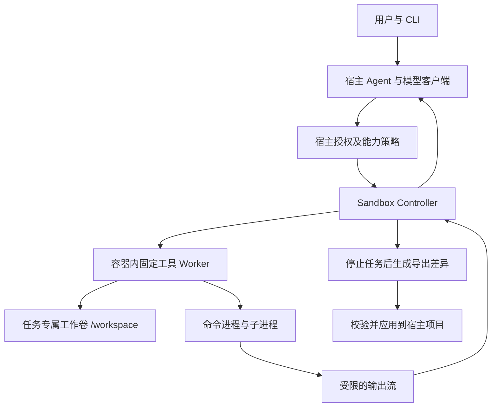

# study_coder Sandbox 构建方案

> 历史方案：本文保留了最初同时设计 local 与 Docker 后端的过程记录。当前实现只保留 Docker 后端；实际启动方式以项目根目录 README 为准。

> 当前状态：S0、S1 已完成代码和本机真实 Docker 验收；S2 的受控联网、预览服务、恢复及清理能力已补入代码，需在 Docker Engine 28+ 上完成后续真实容器验收；S3 仍为后续设计。
>
> 2026-09-24 的 57 项测试和 Docker 验收是 S0/S1 的历史基线，不覆盖本轮新增的 S2 实现。当前执行环境没有可用的 Docker CLI，因此本轮只完成代码审查与静态检查。

## 1. 目标与方案选择

本项目已经允许模型调用多种开发工具，并支持为耗时命令指定超时。下一阶段应为常见的代码生成、依赖安装、构建、测试和调试命令建立独立执行环境，限制其访问宿主文件、凭据、网络及计算资源。

建议采用 **Windows 宿主 + Docker Desktop 的 WSL 2 Linux 容器**：宿主运行 Agent、模型客户端和授权策略；工具在任务专属容器中操作一份独立的工作区副本。基础镜像提供常用开发工具；需要额外工具链时选择受信任的扩展镜像或在允许联网的任务中安装依赖。

这是一条需要按本机条件验证的实施路线。当前电脑已完成 Docker/WSL 2 Linux 容器验证。其他电脑仍须先运行 `sandbox doctor`；预检不通过时明确停止 sandbox 任务，不得自动退回宿主执行。

| 选项 | 适用情况 | 代价与定位 |
|---|---|---|
| Docker Desktop + WSL 2 Linux 容器 | 常见 Linux 开发命令、构建和测试 | 便于自动创建、回收和采集结果；Windows 原生脚本及依赖需要兼容处理 |
| Windows Sandbox | 手动试验不可信 Windows 程序 | 基于虚拟化、环境可丢弃；自动任务管理和工具链预装需要额外设计 |
| 独立虚拟机或远程隔离主机 | 更高风险代码、希望缩小与个人电脑的联系 | 管理和资源开销较大，适合后续加强 |
| 当前宿主执行方式 | 明确选择的可信本地实验 | 保留兼容入口，但必须显示没有操作系统隔离 |

Windows Sandbox 的虚拟化隔离与临时环境特性见 [Microsoft 官方说明](https://learn.microsoft.com/en-us/windows/security/threat-protection/windows-sandbox/windows-sandbox-overview)。容器的进程、文件系统和网络配置见 [Docker 运行文档](https://docs.docker.com/engine/containers/run/)。

## 2. 当前代码提供的保护及缺口

| 当前位置 | 已有行为 | Sandbox 需要补齐的部分 |
|---|---|---|
| `src/study_coder/tools/base.py` | 文件工具验证解析后路径是否在 workspace 内 | 开发命令可直接访问其他路径，绕过这些工具函数 |
| `src/study_coder/tools/bash.py` | 命令白名单、参数数组、`cwd`、可选 `timeout_s` | cwd 仅决定启动目录；没有宿主文件、网络、资源的隔离 |
| `src/study_coder/permissions.py` | 副作用确认，支持 `--yes` | 授权后程序仍以宿主用户的访问权限执行 |
| `src/study_coder/config.py` | 从环境与 `.env` 读取模型配置 | 需避免将宿主环境、凭据文件暴露给执行器 |
| `src/study_coder/session.py` | 会话 JSON 保存在工作区中 | Sandbox 模式应将控制记录移到容器不可写的宿主目录 |
| `src/study_coder/context.py` | 压缩模型输入视图 | 不约束被执行程序；也不能解决模型接口持续等待的问题 |

`shell=False` 主要用于避免额外的 shell 解析；它不会限制子进程的文件权限。现有白名单和禁止管道、重定向的规则也限制了正常开发操作。在容器后端可以重新设计命令语义，宿主模式继续保留原有约束。[Python subprocess 文档](https://docs.python.org/3/library/subprocess.html#security-considerations)

还需修正一处资源边界：当前 `capture_output=True` 会先收集完整输出，再截断返回文本。返回给模型的字符上限不能限制命令运行期间的内存或磁盘占用。

## 3. 保护范围

首期需要阻止或限制以下行为：

- 生成的脚本、项目测试和安装脚本访问宿主其他工程、用户目录、模型 API key、SSH 或云服务凭据。
- 命令通过绝对路径、链接或解包路径写出任务工作区。
- 未授权网络访问，包括宿主代理、局域网服务和外部地址。
- 子进程在超时或取消后继续运行。
- 程序无限输出、无限派生进程或耗尽分配的内存。
- Sandbox 故障时自动在宿主上重试同一条命令。

容器隔离仍依赖运行时、内核、宿主配置和镜像维护。首期不宣称防御所有容器逃逸。对更高风险任务，应选择专用虚拟机或远程隔离主机。

## 4. 总体架构



### 4.1 宿主控制层

宿主保留模型客户端、API key、消息历史、摘要缓存、权限策略和容器生命周期控制。Docker 管理权限仅交给 Controller，不向模型暴露任意 Docker 参数，也不把 Docker socket 或 Windows Docker 命名管道交给容器。

Controller 使用独立的执行后端接口。模型只能提交工具参数，如 `command`、相对路径、`timeout_s`；镜像、挂载、网络、用户和资源上限由可信配置决定。

### 4.2 容器工具层

Sandbox 模式下，六个工具全部操作同一份容器内工作区。包括文件读写、搜索以及 `bash` 中的 `ls/dir/pwd`，都应进入容器 Worker。

只将 `bash` 放入容器、继续由宿主文件工具读取原工程，会导致模型看到两份不同状态；若共享可写目录，还需要面对链接替换和并发修改。首期采用独立副本，减少这一类边界问题。

Worker 安装在只读镜像路径中。宿主通过固定入口和有大小上限的 JSON 协议传递请求，不在 Windows 宿主上解释命令字符串。容器内可以根据工具参数选择直接执行或使用 Linux shell 执行管道、重定向及连续命令；两种模式都受相同的容器边界、工作目录和资源策略约束。工作区文件、命令输出及 Worker 返回内容均按不可信数据校验。

Sandbox 模式的 `bash` 不应沿用宿主命令白名单作为主要安全边界。一般开发命令可在容器内执行，禁止能力应通过不挂载宿主敏感目录、不暴露管理接口、限制网络和资源来落实。容器可执行 Linux 命令；Windows 专用工具需要单独的执行后端，不能假定在 Linux 镜像中可用。

## 5. 工作区导入、执行与导出

### 5.1 导入

1. 用户选择宿主项目目录，Controller 生成任务标识及文件清单。
2. 构建内容快照，记录相对路径、大小和内容哈希。
3. 默认排除 `.env`、私钥、凭据配置、`.git`、宿主虚拟环境及控制日志。排除列表必须支持用户补充；通用文件名规则无法识别所有秘密。
4. 大型数据集通过单独的数据导入配置处理，不默认复制整个磁盘或用户目录。
5. 首期拒绝符号链接、Windows junction/reparse point、硬链接归档条目、设备文件和管道；报告受影响文件。需要这些类型的项目另行扩展支持。
6. 使用受限归档协议导入任务专属 Docker volume，由受信任的初始化步骤设置非 root 用户所需权限。

Linux 容器使用 `/workspace`，模型在工具调用中使用相对路径。宿主的 `D:\study\test` 不应作为可访问路径传入容器命令。Windows 上构建的虚拟环境、二进制依赖和工具缓存不跨平台复制；依赖由镜像或容器环境建立。

### 5.2 执行

每个任务使用一个容器及独立工作卷，任务内顺序执行工具。工作区内安装的依赖、缓存和生成文件可跨轮保留；根文件系统保持只读，临时目录使用有限大小的 tmpfs。

取消或超时时销毁执行中的容器，并保留任务卷以供恢复或导出。后续需要继续时，从同一批准镜像启动新容器挂载任务卷。宿主进程状态、网络连接和后台服务不作为恢复内容。

### 5.3 导出与应用

先停止所有可修改工作卷的容器，再以只读方式提取结果，避免边生成归档边修改文件。宿主不得直接信任容器提供的路径、哈希或“验证成功”声明。

导出器需要验证：

- 只接受普通文件和目录；拒绝绝对路径、`..`、链接、设备文件及危险元数据。
- 拒绝 Windows 盘符逃逸、UNC 路径、保留设备名、NTFS 备用数据流路径及大小写冲突。
- 限制单文件大小、文件数量和解包总字节数；流式处理，不能只检查归档表面大小。
- 重新计算内容哈希，与导入快照比较，生成新增、修改和删除清单。
- 应用前再次验证宿主目标及父目录，拒绝链接和 reparse point；检测用户在任务期间的并发修改，存在冲突时保留结果并报告。

默认先展示差异，再由用户明确应用；同时提供用户预先配置的自动应用策略。现有 `--yes` 仅继续表示工具操作预授权，不自动赋予网络、宿主目录或导出覆盖权限。不要对已经明确预授权的同一动作重复询问。

只备份压缩摘要不足以恢复工作文件；导入清单、原始会话、工具结果、导出差异及实际应用结果应分开保存。

直接可写 bind mount 会让容器修改宿主挂载路径，因而不作为首期默认方案。其行为见 [Docker bind mounts 文档](https://docs.docker.com/engine/storage/bind-mounts/)。

## 6. 首期容器策略

以下为 Docker 后端的默认策略；只有显式启用并成功预检后才会生效。

| 项目 | 初始策略 | 执行责任 |
|---|---|---|
| 容器用户 | 固定非 root 用户 | 镜像与 Controller |
| Linux capabilities | 全部移除；禁止提权 | Controller |
| seccomp | 使用已验证的默认配置，不采用 unconfined | Controller |
| 根文件系统 | 只读 | Controller |
| 可写区域 | 任务专属 `/workspace`、受限临时目录 | Controller |
| 网络 | 默认 `none` | Controller |
| CPU / 内存 / 进程数 | 示例：2 CPU、4 GiB、128 进程 | 容器运行时 |
| 命令默认时长 | 60 秒，保留模型可选 `timeout_s` | 宿主策略与 Controller |
| 命令最长时长 | 示例：默认任务 1800 秒；用户可为长时任务配置更高上限 | 用户选择的任务 profile |
| 单命令输出 | 示例：传输上限 1 MiB，模型视图另按现有字符预算截断 | 输出读取器 |
| 磁盘 | 初期监测容量、限制导入导出大小；不声称具备硬配额 | Controller 与宿主监控 |
| 宿主凭据 | 不导入、不挂载、不继承环境变量 | 导入器与启动器 |
| 宿主管理接口 | 不挂载 Docker socket、命名管道或其他管理端点 | Controller |

Docker 默认并不替项目设置 CPU 或内存上限，必须显式配置。[资源限制文档](https://docs.docker.com/engine/containers/resource_constraints/)

普通 Docker volume 不能仅靠一个内存参数获得磁盘硬配额。若验收要求严格限制写盘，需要支持配额的存储方案或独立、限制容量的虚拟磁盘；容量轮询只能降低风险，不能保证写盘上限。

非 root 容器用户与 rootless Docker 是不同层次。Linux 执行节点可进一步评估 rootless Docker；不能因为容器里使用非 root 用户，就宣称 Docker daemon 也以 rootless 方式运行。[Rootless 文档](https://docs.docker.com/engine/security/rootless/)

## 7. 开发工具、依赖和网络

### 7.1 常见开发命令

宿主模型客户端的联网与容器联网独立。即使 Agent 使用远程模型，容器仍可以采用 `--network none`。镜像拉取发生在宿主运行时，属于预配置步骤；不会因此让执行中的容器自动获得外网权限。[None 网络驱动说明](https://docs.docker.com/engine/network/drivers/none/)

基础镜像应包含文件查看、搜索、Git、编译构建及常见语言运行时等工具，并通过 `doctor` 列出实际可用命令及版本。选定镜像缺少所需工具时，应返回明确错误，并允许用户选择受信任的扩展镜像。兼容目标是大部分基于 Linux 的开发命令，不承诺任何命令在任意镜像中都可运行。

容器内允许单条命令，以及管道、重定向、连续命令等常见 shell 用法。Worker 不把命令插入宿主 shell；它只在任务容器中解释命令，并限制工作目录、输出、执行时长和资源。`sudo`、容器管理或挂载等操作即使写入命令，也不应获得宿主权限。

### 7.2 安装依赖和联网

离线 profile 用于已有依赖的构建和测试。要覆盖常见的初始化、依赖安装和下载任务，还需要用户选择的联网 profile。目标是受控出口：隔离网络中的任务容器仅能联系指定代理，代理控制目标域名、端口、请求时长和流量预算。

仅设置 `HTTP_PROXY` 并不强制程序使用代理。必须同时用网络拓扑或防火墙阻止直接出网、宿主与局域网访问，并覆盖 DNS、IPv6、重定向和代理 CONNECT 等路径。目标域名解析到私有、回环或链路本地地址时应拒绝。若平台不能兑现这些限制，该 profile 应报不可用，而不能标记为“仅允许下载”。

包管理器可能访问仓库之外的镜像或安装脚本资源。允许列表由用户配置；被拒绝时返回具体目标供用户决定。跨任务缓存应视为不可信依赖来源，不默认共享可写缓存。基础镜像保持只读；需要安装系统级依赖的任务使用受信任的扩展镜像或专门的构建流程，不为普通执行容器开放提权。

### 7.3 长时命令与后台服务

安装、构建、测试等命令沿用模型可选的 `timeout_s`，但受用户配置的任务上限约束。执行期间提供进度和持续时间日志；任务取消或超时后清理整个容器内的进程树。

需要持续运行的预览服务或调试服务，应通过 `start_service / stop_service` 生命周期管理，不靠无限延长单次命令超时。Controller 记录服务进程、健康状态和明确批准的端口映射；预览端口仅绑定宿主回环地址。

## 8. 超时、取消和日志

有效命令超时应由宿主计算：未传 `timeout_s` 时使用默认值；显式值超过当前 profile 上限时返回清楚的策略错误，避免静默截断后产生误解。LLM 无权修改 profile 上限。

Controller 必须独立计时，不能只相信容器里的超时逻辑。超时或 Ctrl+C 时：先发出停止请求，短暂等待后强制停止目标容器，再检查容器确实退出；只结束宿主 `docker exec` 客户端不能作为清理成功的依据。清理失败时隔离该任务并报告，禁止继续运行。

输出读取器并发读取 stdout/stderr，限制累计字节并持续排空超额输出，或者按配置直接终止输出失控的命令。模型结果中的“截断”与命令真实退出码应分开表示。

建议日志形式：

```text
[沙箱] 已启动：profile=general，网络=禁用，CPU=2，内存=4GiB
[工具调用] "bash" 参数={"command":"make test","timeout_s":300}
[命令运行] 已运行 30 秒，仍在等待退出
[命令输出] ...
[工具结果] "bash" 状态=成功 内容="exit code: 0 ..."
[沙箱] 已生成导出差异：新增 3，修改 1，删除 0
```

沿用当前终端日志不显示工具调用 ID 的约定。内部仍保留关联标识用于取消、审计和恢复。命令输出、状态消息及 Worker 协议应分开传输，避免命令伪造 JSON 控制结果。

模型请求等待和上下文摘要等待仍需由 Agent/LLM 层处理。Sandbox 不会修复远端模型慢响应；`request_timeout_s` 与 `timeout_s` 继续分别控制模型通信与工具命令。

## 9. 代码改造清单

建议新增以下模块，目录命名可在实现时调整：

```text
src/study_coder/sandbox/
    base.py          # WorkspaceRuntime 协议、请求和结果类型
    policy.py        # profile、网络、资源和时长规则
    docker.py        # DockerRuntime 与容器生命周期
    local.py         # 当前宿主模式的兼容后端
    worker.py        # 容器内固定入口及文件/命令操作
    transfer.py      # 快照导入、安全导出与冲突检测
    logs.py          # 有界输出及状态事件
    manifest.py      # 宿主任务记录和资源归属
sandbox/images/
    general.Dockerfile # 常见开发工具的基础镜像
    extensions/       # 按项目需要维护的受信任工具链镜像
tests/
    test_sandbox_policy.py
    test_sandbox_transfer.py
    integration/test_sandbox_runtime.py
```

接口至少需要 `start`、`execute_tool`、`cancel`、`export_changes`、`close`。命令结果应区分正常完成、非零退出、超时、用户取消、策略拒绝、容器故障和输出截断。

| 现有模块 | 拟修改内容 |
|---|---|
| `tools/base.py` | 给 `ToolContext` 注入运行后端；将工具参数验证与具体文件操作分离 |
| `tools/bash.py` | 保留默认 60 秒语义；sandbox 后端支持容器内常见 shell 命令，local 后端维持原有白名单和平台启动逻辑 |
| `tools/read.py`、`search.py`、`edit.py` | Sandbox 模式下通过 Worker 操作容器工作卷 |
| `agent.py` | 在工具权限检查后调用后端；将容器失败变为配对完整的工具结果 |
| `permissions.py` | 区分工具操作授权与网络、导出等宿主能力授权 |
| `config.py`、`cli.py` | 增加后端、profile、预检及导出配置；启动时显示实际生效模式 |
| `session.py` | Sandbox 模式把会话和任务清单保存在宿主私有状态目录 |
| `prompt.py` | 告知模型工作区路径、有效工具、网络状态和时长上限；不依赖提示词执行隔离 |

镜像只从本项目可信 Dockerfile 构建；启动时记录其不可变 image ID，任务和导出均使用该 ID。当前基础镜像的上游标签仍需在正式部署时固定 digest。初期不执行目标仓库自带的任意 Dockerfile。Docker 管理客户端只由 Controller 调用，不加入模型的工具白名单。

## 10. 拟新增配置与调用方式

下列变量及命令已接入 CLI。首次运行前先执行 `study-coder sandbox build`，再执行 `sandbox doctor`。

```dotenv
STUDY_CODER_EXECUTION_BACKEND=docker
STUDY_CODER_SANDBOX_PROFILE=general
STUDY_CODER_SANDBOX_NETWORK=none
STUDY_CODER_SANDBOX_NETWORK_ALLOWLIST=
STUDY_CODER_SANDBOX_NETWORK_MAX_BYTES=536870912
STUDY_CODER_SANDBOX_CPUS=2
STUDY_CODER_SANDBOX_MEMORY_MB=4096
STUDY_CODER_SANDBOX_PIDS_LIMIT=128
STUDY_CODER_COMMAND_TIMEOUT_S=60
STUDY_CODER_SANDBOX_MAX_COMMAND_TIMEOUT_S=1800
STUDY_CODER_SANDBOX_COMMAND_OUTPUT_BYTES=1048576
STUDY_CODER_SANDBOX_WORKSPACE_MAX_BYTES=1073741824
STUDY_CODER_SANDBOX_WORKSPACE_MAX_FILES=50000
STUDY_CODER_SANDBOX_ALLOW_WEB_SEARCH=false
STUDY_CODER_SANDBOX_SERVICE_PORTS=
STUDY_CODER_SANDBOX_APPLY=review
```

这里的 `.env` 属于宿主配置。Controller 通过明确允许的环境变量列表构造容器环境，不把整个 `os.environ` 或宿主 `.env` 传入容器。未配置的可选能力按禁止处理。

```powershell
# 先构建本项目提供的可信镜像，再检查执行环境
uv run study-coder sandbox build --profile general
uv run study-coder sandbox doctor --profile general

# 在容器工作区中完成开发任务，任务结束后检查导出差异
uv run study-coder -C D:\study\test --sandbox docker --sandbox-profile general -p "修复项目中的问题并运行测试" --yes
```

为保持升级兼容，首次接入可保留现有 local 默认模式，但启动时明确显示“宿主执行，无操作系统隔离”。Docker 后端通过验收后，再由用户配置为默认。用户显式选择 Docker 时，预检失败必须停止。

## 11. 生命周期与恢复

```text
created → importing → ready → running → ready
                         ↓        ↓
                      exporting  timeout/cancel/failure
                         ↓        ↓
                     awaiting_apply → stopped
                         ↓
                     applied / retained
```

宿主清单记录任务标识、原工程根目录、镜像 digest、有效策略、导入哈希、容器和 volume 归属、最后状态、导出位置。原始会话与工具结果增量保存，避免只在最终回复后保存。

重启时只认领本项目已记录且归属匹配的资源；校验镜像和策略后才能继续。恢复命令默认不自动重新执行可能产生副作用的上一次任务。

清理仅针对明确属于该任务的容器、volume 和临时文件。不得执行全局 `docker system prune`；仍待导出的工作卷需保留并列出位置。宿主目录删除或移动前，必须解析并核验最终路径。

## 12. 实施阶段与交付条件

| 阶段 | 交付物 | 完成条件 |
|---|---|---|
| S0：接口与预检 | 后端协议、原有 local 工具兼容、profile 校验、doctor | 已完成；Docker 不可用时不退回宿主，历史真实 doctor 已通过 |
| S1：离线隔离闭环 | 通用开发镜像、任务卷、六工具 Worker、常见 shell 命令、超时取消、有界输出、安全导出 | 已完成；历史代码、单元测试和真实容器集成测试通过 |
| S2：常见项目工作流 | 受控出口、依赖安装、恢复及长驻服务生命周期 | 代码已完成；Docker Engine 28+ 的真实隔离、绕过和恢复验收待执行 |
| S3：扩展工具链 | 受信任的扩展镜像、项目工具预检、可选远程执行节点 | 多种项目类型可选择合适工具链，缺少工具时明确报错 |

S1 是首个隔离执行版本；覆盖大部分需要依赖安装的开发任务以 S2 为目标。S0 的接口抽象或 mock 测试通过，不代表 Sandbox 已具备隔离能力。

S1 加固实现：Sandbox 默认移除宿主 `web_search`；导出对全部 tar 文件成员计入容量和数量上限；导入通过同一文件句柄校验文件身份与读取期间变化；应用差异保存事务日志和磁盘备份，流式校验并原子替换文件，提供失败回滚与 `sandbox recover`；启动失败按资源标签清理，提供 `sandbox list/cleanup`；命令执行监控工作区逻辑大小与文件数，并回收命令派生进程。工作区监测是逻辑限制，不是 Docker volume 硬磁盘配额。单个传输文件仍有 16 MiB 上限。

服务生命周期已提供 `start_service/stop_service`：仅在用户配置批准端口后启用，端口绑定 `127.0.0.1`，容器使用 Docker internal isolated 网络，服务监视器沿用工作区逻辑容量限制。受控网络使用独立代理容器：任务端只连接 IPv4/IPv6 gateway 均为 isolated 的 internal 网络，代理检查白名单域名、目标公网地址、HTTP/HTTPS 端口与 TLS SNI，并实施每任务字节和连接时限。该能力保持默认关闭，必须通过真实 Docker 的直连绕过、宿主访问、DNS rebinding、TLS SNI 与下载兼容验收后才适合启用。HTTPS 内容不解密，必须把允许的域名视为可信出口。

## 13. 验收矩阵

所有破坏性验证均在专用测试目录或隔离环境中完成，使用无敏感内容的标记文件与假凭据。

| 测试 | 操作 | 预期 |
|---|---|---|
| 基本闭环 | 修改文件、读回、运行构建和测试、导出 | 六工具观察到相同文件；结果可应用 |
| 通用命令 | 在容器内执行普通程序、管道、重定向和连续命令 | 命令按预期执行，宿主不解释命令字符串 |
| 工具链预检 | 选择基础镜像及扩展镜像，调用已有和缺失工具 | 正确列出版本；缺失工具有明确错误 |
| 宿主目录隔离 | 在工作区外放置唯一标记，尝试从容器内的开发命令读取 | 标记不可见，宿主文件未变化 |
| 凭据隔离 | 宿主设置假 API key，并在配置目录写假密钥 | 容器环境和导入文件均不存在它们 |
| 导出逃逸 | 构造 `../`、绝对路径、链接、Windows 特殊路径和大小写冲突 | 宿主拒绝导出，目标目录外没有写入 |
| 并发修改 | 用户在任务期间修改相同宿主文件 | 报冲突，不覆盖用户改动 |
| 无网络模式 | 访问公网、DNS、宿主网关与局域网测试服务 | 均无法建立未授权连接 |
| 网络允许列表 | 访问批准地址、未批准地址和跳转目标 | 只允许批准范围，绕过代理失败 |
| 超时后代清理 | 命令派生后台写入进程并触发超时 | 容器停止，写入停止，无残留任务进程 |
| 用户取消 | 长命令运行时取消 | 有明确取消结果，卷保留，容器停止 |
| 资源限制 | 在隔离环境中超量分配内存、派生进程、输出文本 | 不超过已配置边界；明确报告失败或截断 |
| 运行时故障 | 执行前关闭 Docker 或使用无效镜像 | 清楚报错，宿主无同名命令启动 |
| 隔离回退 | 容器启动失败后检查后端行为 | 不自动切换 local |
| 恢复与清理 | Controller 重启、孤儿容器、待导出工作卷 | 只操作本任务资源，保留可恢复结果 |

单元测试覆盖参数、策略与归档路径；集成测试必须使用真实容器。报告中分别列出 Windows 本机、离线命令、联网依赖安装的验证结果；未运行的项标记为“未验证”。

### 13.1 本机真实容器验收记录（2026-09-24；S0/S1 历史基线）

- `sandbox doctor` 通过，确认 Linux daemon、不可变镜像 ID及只读非 root Worker 可启动。
- 真实任务容器确认用户为 UID 10001、根文件系统只读、capabilities 全部移除、网络模式为 `none`，CPU、内存和进程数限制写入 Docker 配置。
- 文件工具与 shell 共用任务 volume；管道和重定向可用；宿主环境变量及工作区 `.env` 不进入容器。
- 超时命令派生的后台进程被终止，没有延迟写入文件；导出结果在应用前不修改宿主，并能通过审阅流程应用。
- 完整测试结果为 `57 passed`，Ruff 与 mypy 均通过；测试结束后没有遗留任务容器或 volume。
- 当时 S2 的受控联网、允许列表、预览服务和任务恢复尚未实现，且未作为该轮 S1 验收项；这些能力之后加入代码，仍需重新进行真实容器验收。

## 14. 官方参考

- [Python subprocess 安全说明](https://docs.python.org/3/library/subprocess.html#security-considerations)：启动方式与 Windows 批处理特殊行为。
- [Docker 运行容器](https://docs.docker.com/engine/containers/run/)：容器启动、用户、挂载和资源选项。
- [Docker bind mounts](https://docs.docker.com/engine/storage/bind-mounts/)：宿主目录暴露及读写语义。
- [Docker 默认 seccomp](https://docs.docker.com/engine/security/seccomp/)：系统调用过滤配置。
- [Docker 资源限制](https://docs.docker.com/engine/containers/resource_constraints/)：CPU 与内存限制。
- [Docker none 网络](https://docs.docker.com/engine/network/drivers/none/)：禁用容器外部网络。
- [Docker rootless 模式](https://docs.docker.com/engine/security/rootless/)：Linux 上降低 daemon 与容器权限。
- [Windows Sandbox](https://learn.microsoft.com/en-us/windows/security/threat-protection/windows-sandbox/windows-sandbox-overview)：临时虚拟化环境。
- [Windows Sandbox 配置](https://learn.microsoft.com/en-us/windows/security/application-security/application-isolation/windows-sandbox/windows-sandbox-configure-using-wsb-file)：网络、目录映射和资源配置。
